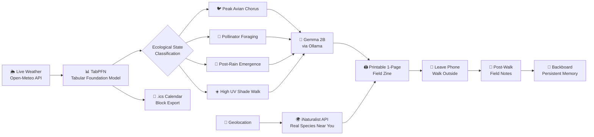

# 🌿 FieldCast Studio

**An open-source micro-climate ecological predictor + printable 1-page field zine + acoustic bird spectrogram kit.**

FieldCast Studio gets software engineers off their screens and into nature in under 20 seconds. It predicts the best time to go outside using AI, prints a physical field guide so you leave your phone behind, and remembers your nature sightings across sessions.


---

## The Problem

Software engineers average **11+ hours of daily screen time**. When they need an outdoor break, they face three decision-fatigue barriers:

1. **When?** — Is now actually a good time weather-wise?
2. **What do I do?** — Aimless walks feel pointless and end quickly.
3. **How do I unplug?** — Every "nature app" requires staring at a phone screen.

## The Solution

FieldCast Studio uses **two open-weight AI models** (one for numbers, one for language) to eliminate all three barriers:



## Features

| Feature | Technology | What It Does |
|---|---|---|
| **Ecological Window Predictor** | Prior Labs TabPFN v2 | Classifies 8 micro-climate CSV features into 4 ecological states |
| **Printable Field Zine** | Google Gemma 2B (Ollama) | Generates a `@media print` 1-page zine with species bounties |
| **Real Nearby Species** | iNaturalist Open API | Shows birds, plants, insects spotted within 5 km in the last 14 days |
| **Auto Weather Sync** | Open-Meteo + Geolocation | Detects your location and pulls live weather data |
| **Calendar Block Export** | .ics (RFC 5545) | Downloads a calendar invite to block off your optimal outdoor window |
| **FFT Bird Spectrogram** | Web Audio API | Visualizes audio frequencies to identify bird calls by pitch |
| **Persistent Memory** | Backboard.io SDK | Remembers your sightings and field notes across sessions |
| **Eyes-Up Audio Briefing** | Web Speech Synthesis | Reads your field bounties aloud so you don't need to look at the screen |
| **Post-Walk Markdown Log** | Client-side export | Exports a dated `.md` field journal with all your observations |

## Quick Start

### Run Locally

```bash
# Clone the repo
git clone https://github.com/YOUR_USERNAME/fieldcast-touch-grass.git
cd fieldcast-touch-grass

# Install dependencies
pip install -r requirements.txt

# Start the server
uvicorn app:app --reload --port 8000
```

Open [http://localhost:8000](http://localhost:8000) in your browser.

### Deploy to Render (1-Click)

1. Push this repo to GitHub
2. Go to [dashboard.render.com](https://dashboard.render.com) → **New +** → **Web Service**
3. Connect your `fieldcast-touch-grass` repository
4. Render reads `render.yaml` and auto-deploys in ~2 minutes

### Optional: Local Gemma 2B (Ollama)

For fully offline, private field zine generation:

```bash
# Install Ollama (https://ollama.com)
ollama pull gemma2:2b
ollama serve
```

The app will automatically detect Ollama and use Gemma 2B for zine generation. Without Ollama, it falls back to curated biome presets.

## Project Structure

```
fieldcast-touch-grass/
├── data/
│   └── trail_observations.csv   # 32-row micro-climate dataset (8 features → 4 ecological classes)
├── static/
│   └── index.html               # Full UI: Dashboard + Printable Zine + Audio FFT + iNaturalist
├── app.py                       # FastAPI: TabPFN + iNaturalist proxy + Calendar .ics + Backboard
├── requirements.txt             # Python dependencies
├── render.yaml                  # Render deployment blueprint
└── README.md
```

## How the AI Models Work Together

### TabPFN (Tabular Data → Probabilities)
Weather data is fundamentally **tabular numbers**. Asking a text LLM to guess probabilities from CSV rows leads to hallucinated math. TabPFN is a tabular foundation model purpose-built for this: it takes 8 numerical features and outputs calibrated class probabilities with zero hyperparameter tuning.

### Gemma 2B (Probabilities → Natural Language)
Once TabPFN produces the ecological classification, Gemma 2B translates it into a human-readable, printable field guide with specific species to look for, sensory exercises, and walking meditation prompts. Each model does what it's mathematically built for.

## Why Open Innovation Matters

- **Privacy:** Your coordinates and personal reflections never touch a third-party commercial AI server.
- **Offline-Ready:** Both TabPFN and Gemma 2B run on a standard laptop CPU with zero internet needed.
- **Zero Cost:** No API keys, no token billing, no vendor lock-in.
- **Customizable:** Upload your own CSV dataset and TabPFN re-fits in-context instantly.

## License

MIT
